<p align="center"></p>

<p align="center"><b>Your Claude usage, as a game.</b> Earn XP, keep your streak, clear daily quests and unlock trophies for Claude Code and claude.ai.<br>Everything stays on your own computer.</p>

<p align="center">
  <a href="https://github.com/jkaridis-bit/usage-quest-releases/releases/latest"></a>
  
  
</p>

## 🕹️ PLAYER 1: CHOOSE YOUR PLATFORM

<p align="center">
  <a href="https://github.com/jkaridis-bit/usage-quest-releases/releases/latest/download/UsageQuest-Setup.exe"></a>
  <a href="https://github.com/jkaridis-bit/usage-quest-releases/releases/latest/download/UsageQuest-Mac.dmg"></a>
</p>

- **Windows:** [Download UsageQuest-Setup.exe](https://github.com/jkaridis-bit/usage-quest-releases/releases/latest/download/UsageQuest-Setup.exe) (64-bit, no admin needed)
- **Mac:** [Download UsageQuest-Mac.dmg](https://github.com/jkaridis-bit/usage-quest-releases/releases/latest/download/UsageQuest-Mac.dmg) (Apple Silicon and Intel)

These links always get the newest version.

```text
  LEVEL 1     LEVEL 2     LEVEL 3
  DOWNLOAD ─> INSTALL ──> CONNECT ─> PLAY!

  ████████    ▓▓▓▓▓▓▓     ░░░░░░░
```

## LEVEL 2: INSTALL

### Windows

1. Open **UsageQuest-Setup.exe** from your Downloads. If your browser says the file isn't commonly downloaded, choose **Keep**.
2. **⚔️ BOSS: Windows SmartScreen.** The first time, Windows says **"Windows protected your PC"** because the installer isn't code-signed yet. Click **More info**, then **Run anyway**.
3. Usage Quest installs for your user only (no admin password) and opens by itself.

Updates install themselves: the app downloads them in the background and finishes when you close it or click **Restart to update**.

### Mac

1. Open **UsageQuest-Mac.dmg** and drag **Usage Quest** into **Applications**.
2. Open Usage Quest from Applications. macOS says it can't verify the app: click **Done** (not Move to Trash).
3. **⚔️ BOSS: macOS Gatekeeper.** Open **System Settings → Privacy & Security**, scroll down to **Security**, and next to "Usage Quest was blocked to protect your Mac" click **Open Anyway**. It's there for about an hour after step 2.
4. Click **Open Anyway** again and enter your Mac password (or use Touch ID).

After that it opens normally. Control-click → Open no longer skips this on macOS 15 and later.

The Mac app isn't signed by Apple yet, so you'll do steps 2–4 once for each new version. When one is out, the app shows a **Download** button. Get the new `.dmg`, drag it into Applications again (replace the old one), and open it.

## LEVEL 3: CONNECT claude.ai

1. Usage Quest opens on **Welcome to Usage Quest**: click **Connect claude.ai**. (If you use Claude Code, it may open straight to your dashboard. Click **Connect claude.ai** in the **Weekly stamina** card instead.)
2. Sign in to claude.ai in the window that opens, the way you normally do. If Google sign-in is blocked there, use **Continue with email**.
3. That's it. Your XP comes from the usage meter on your claude.ai usage page, which refreshes every 5 minutes while the app is open. Claude Code on this computer counts too, with no setup.

You sign in with claude.ai directly: Usage Quest never sees your password, and reading the meter uses none of your Claude usage.

## 🏆 WHAT YOU UNLOCK

<p align="center"></p>

| ITEM | WHAT IT DOES |
| --- | --- |
| **XP and levels** | Every bit of Claude use earns XP: the Claude app, Cowork and Claude Code. |
| **Streaks** | Use Claude every day to keep your streak going. |
| **Daily quests** | Small goals that reset every day. |
| **Trophies** | Unlock them as you hit milestones. |
| **Weekly stamina** | Your claude.ai session and weekly limits, live. |
| **Time bank** | An estimate of the time Claude saved you. |
| **Charts and themes** | Your days, hours, models and projects, in the theme you like. |

## 💾 SAVE FILE

Everything Usage Quest knows stays on your computer:

- It reads the numbers on your claude.ai usage page and, if you use Claude Code, its logs on this computer. Nothing else.
- It never sends your usage anywhere. Its only other connection is checking GitHub for updates.
- Your save file lives in `%APPDATA%\Usage Quest\data` on Windows and `~/Library/Application Support/Usage Quest/data` on a Mac. It keeps your history even after Claude Code clears its own logs.

## ❓ CONTINUE?

<details>
<summary><b>Does it work if I don't use Claude Code?</b></summary>

Yes. Most players only use the Claude app or Cowork. The claude.ai usage meter alone earns XP.
</details>

<details>
<summary><b>Does it start with my computer?</b></summary>

Yes, quietly in the background, so the meter keeps counting. Open the app from the Start menu, the Dock or Applications whenever you want to look.
</details>

<details>
<summary><b>How do I uninstall it?</b></summary>

- **Windows:** Settings → Apps → Installed apps → **Usage Quest** → **Uninstall**.
- **Mac:** quit Usage Quest (Cmd+Q) and drag it from Applications to the Trash. To stop its background helper too, delete `~/Library/LaunchAgents/UsageQuest.App.server.plist`.

Your save file stays behind in the folder above, in case you come back. Delete that folder to remove it.
</details>

<details>
<summary><b>Where are the patch notes?</b></summary>

Every version has its own notes on the [Releases](https://github.com/jkaridis-bit/usage-quest-releases/releases) page.
</details>

```text
  GAME OVER? NEVER. INSERT COIN TO CONTINUE
```
